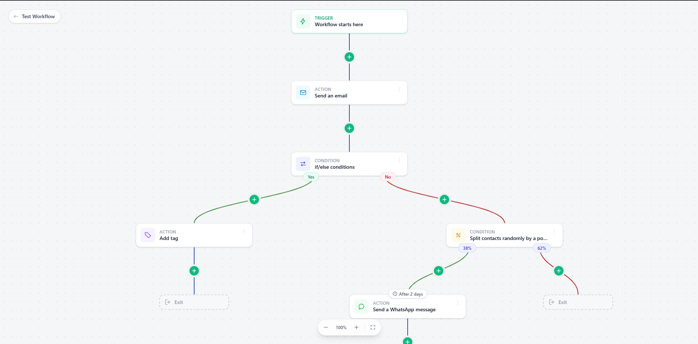

# React Automation Builder

A visual workflow editor for building marketing and contact automations, written in React and TypeScript. Workflows are drawn as a tree that starts from a trigger and branches through actions and conditions until every path reaches an exit.



## Features

- **Tree layout engine** that computes node widths and positions and spaces sibling branches so cards never overlap, whatever the shape of the workflow.
- **Branching conditions**: if/else (yes / no) and random percentage splits, each with its own coloured connectors.
- **Inline editing**: insert a node on any connection with the `+` button, or delete a single node or a whole subtree.
- **Delays** between steps, shown as a badge on the card ("After 2 days").
- **Pan and zoom canvas** that fits and centres the workflow on its trigger, with zoom controls and a fit-to-screen action.
- **Backend-agnostic data model**: workflows are loaded over HTTP as plain JSON (`automations`, `triggers`, `nodes`), so the editor can sit in front of any API.
- No runtime dependencies beyond React and Tailwind CSS. Connectors are rendered as SVG and routing uses the History API.

## Built with

React 19, TypeScript, Vite, Tailwind CSS 4, Oxlint.

## Use cases

The editor is a good fit for products that let users design multi-step, conditional flows:

- Email and SMS marketing platforms (drip campaigns, onboarding sequences)
- CRMs and customer engagement tools (lead nurturing, contact tagging, segmentation)
- E-commerce platforms (abandoned cart and post-purchase flows)
- Messaging and support tools, such as WhatsApp or chat automation
- Internal tools and no-code platforms that need a configurable approval or task pipeline

## Getting started

Requirements: Node.js 20 or later and npm.

```bash
git clone https://github.com/AhmedJguirim/react-automation-builder.git
cd react-automation-builder
npm install
npm run dev
```

Open the URL printed by Vite (by default `http://localhost:5173`). The landing page lists several sample workflows, from an empty trigger to a 23-node tree, served from `public/api`.

Other scripts:

```bash
npm run build     # type-check and build for production
npm run preview   # preview the production build
npm run lint      # run Oxlint
```

## Project structure

```
src/
  components/      Canvas cards, connectors, zoom controls, add-node modal
  hooks/           Pan and zoom behaviour
  lib/
    treeBuilder.ts Layout engine: tree building, widths, coordinates, spacing
    mutations.ts   Pure functions to add and delete nodes
    api.ts         Data fetching
  pages/           Workflow list and builder pages
public/api/        Sample workflows and the node type catalogue (JSON)
```

To connect a real backend, replace the URLs in `src/lib/api.ts` with your own endpoints returning the same shapes defined in `src/types.ts`. New card types can be added in `public/api/node-types.json`.

## Contributing

Contributions are welcome. To propose a change:

1. Fork the repository and create a branch from `master`.
2. Make your changes and run `npm run lint` and `npm run build`.
3. Open a pull request describing what you changed and why.

For bug reports, ideas or questions, open an issue or contact me at [jguirimahmed111@gmail.com](mailto:jguirimahmed111@gmail.com).

## License

Released under the [MIT License](LICENSE).
